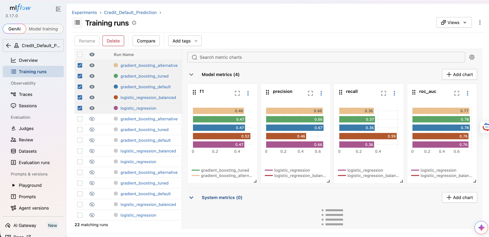
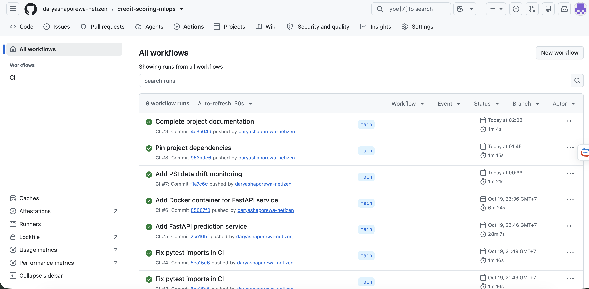
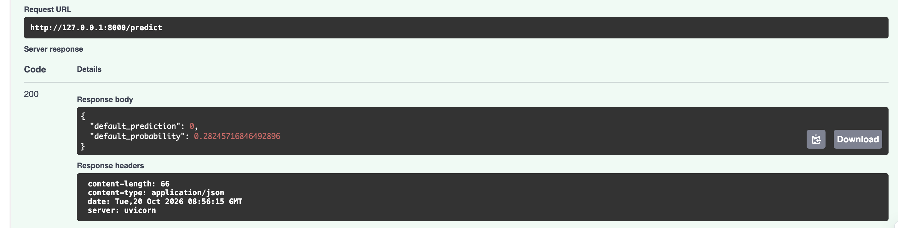
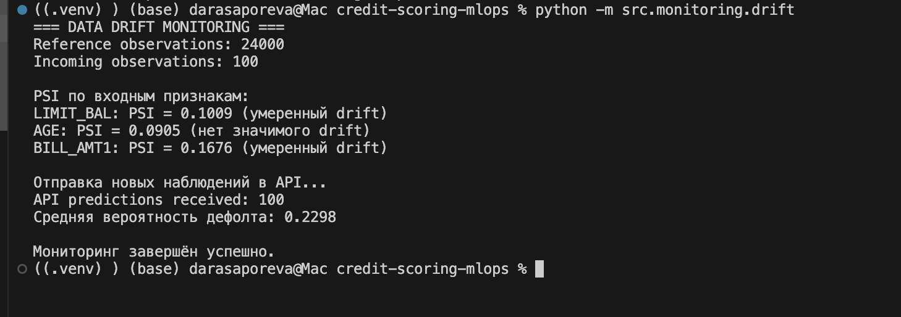

# Credit Scoring MLOps Project

[](https://github.com/daryashaporewa-netizen/credit-scoring-mlops/actions/workflows/ci.yml)

Учебный end-to-end MLOps-проект для прогнозирования дефолта клиента кредитной карты.

Проект выполнен в рамках курса **«Автоматизация процессов разработки и тестирования моделей машинного обучения»**.

## Результат

Финальная модель — **Gradient Boosting Tuned**.

| Метрика | Значение |
|---|---:|
| ROC-AUC | 0.779 |
| Precision | 0.665 |
| Recall | 0.368 |
| F1 | 0.474 |

Всего проведено **5 модельных экспериментов**.

Balanced Logistic Regression показала более высокий Recall (`0.592`) и F1 (`0.520`), поэтому выбор модели зависит от бизнес-приоритета: качества ранжирования риска или максимального обнаружения потенциальных дефолтов.

---

## Архитектура

```text
Raw data
   ↓
Great Expectations validation
   ↓
Feature engineering
   ↓
Train / Test split
   ↓
Model experiments + tuning
   ↓
MLflow
   ↓
Final model
   ↓
DVC
   ↓
Tests + GitHub Actions CI
   ↓
FastAPI
   ↓
Docker
   ↓
PSI drift monitoring
```

---

## Данные

Используется датасет **Default of Credit Card Clients** из UCI Machine Learning Repository.

- наблюдений: `30 000`;
- train: `24 000`;
- test: `6 000`;
- целевая переменная: `default.payment.next.month`;
- `0` — дефолта нет;
- `1` — дефолт произошёл.

Исходный CSV должен находиться по пути:

```text
data/raw/UCI_Credit_Card.csv
```

DVC remote в учебной версии проекта не настроен, поэтому после свежего клонирования исходный файл необходимо добавить вручную.

---

## Подготовка данных

Валидация выполняется через **Great Expectations**.

Проверяются:

- структура данных;
- ожидаемые колонки;
- типы;
- допустимые диапазоны значений.

Отдельный тест намеренно подставляет:

```text
AGE = 150
```

и проверяет, что такие данные отклоняются.

### Feature engineering

Создаются четыре дополнительных признака:

- `AVG_UTILIZATION` — средняя задолженность относительно кредитного лимита;
- `AVG_PAYMENT_RATIO` — средний платёж относительно кредитного лимита;
- `MAX_DELAY` — максимальный статус задержки;
- `DELAY_MONTHS` — количество месяцев с задержкой.

---

## ML Pipeline

Предобработка и модель объединены в `sklearn.Pipeline`.

Для числовых признаков:

```text
SimpleImputer(median)
        ↓
StandardScaler
```

Для категориальных:

```text
SimpleImputer(most_frequent)
        ↓
OneHotEncoder(handle_unknown="ignore")
```

Для Gradient Boosting выполнен подбор гиперпараметров.

Лучшие параметры:

```text
learning_rate = 0.05
max_depth = 3
n_estimators = 150
```

### Эксперименты

| Модель | ROC-AUC | Precision | Recall | F1 |
|---|---:|---:|---:|---:|
| Logistic Regression | 0.761 | 0.662 | 0.359 | 0.465 |
| Logistic Regression Balanced | 0.761 | 0.464 | 0.592 | 0.520 |
| Gradient Boosting Default | 0.779 | 0.666 | 0.365 | 0.471 |
| Gradient Boosting Tuned | 0.779 | 0.665 | 0.368 | 0.474 |
| Gradient Boosting Alternative | 0.773 | 0.658 | 0.356 | 0.462 |

---

## MLflow

MLflow используется для хранения параметров, метрик и model artifacts.

Запуск:

```bash
mlflow ui \
  --backend-store-uri sqlite:///mlflow.db \
  --host 127.0.0.1 \
  --allowed-hosts "127.0.0.1:5000,localhost:5000"
```

Интерфейс:

```text
http://127.0.0.1:5000
```

### Сравнение модельных запусков



`mlflow.db` является локальным Tracking Store и не хранится в Git.

---

## DVC

ML pipeline описан в `dvc.yaml` и состоит из двух основных стадий:

```text
prepare
   ↓
train
```

`prepare` выполняет:

- validation;
- feature engineering;
- train/test split.

`train` выполняет:

- обучение моделей;
- подбор параметров;
- расчёт метрик;
- сохранение модели и результатов.

Запуск всего pipeline:

```bash
dvc repro
```

Если данные и код не изменились, DVC пропускает уже актуальные стадии.

Основные артефакты:

| Артефакт | Назначение |
|---|---|
| `data/processed/train.csv` | обучающая выборка |
| `data/processed/test.csv` | тестовая выборка |
| `models/credit_default_model.pkl` | финальная модель |
| `experiment_results.csv` | результаты экспериментов |
| `metrics.json` | метрики модели |
| `roc_curve.png` | ROC curve |
| `dvc.lock` | состояние DVC pipeline |

---

## Тестирование и CI

Используются:

- `pytest`;
- Black;
- Flake8;
- GitHub Actions.

Локальная проверка:

```bash
python -m pytest -v
black --check src tests
flake8 src tests
```

На момент финальной проверки:

```text
3 passed
```

CI запускается автоматически на `push` и `pull_request` и выполняет:

```text
Black
   ↓
Flake8
   ↓
Unit tests
   ↓
Data validation tests
```



---

## FastAPI

Inference API реализован на **FastAPI**.

Запуск:

```bash
uvicorn src.api.app:app --reload
```

Swagger UI:

```text
http://127.0.0.1:8000/docs
```

Основной endpoint:

```text
POST /predict
```

Пример ответа:

```json
{
  "default_prediction": 0,
  "default_probability": 0.2824571685
}
```

API дополнительно валидирует отдельные запросы через **Pydantic**.

Например:

```text
AGE = 150
```

возвращает:

```text
422 Unprocessable Entity
```

и не передаётся модели.

Таким образом:

- **Great Expectations** контролирует dataset перед обучением;
- **Pydantic** контролирует отдельный inference request.



---

## Docker

FastAPI-сервис контейнеризирован.

Сборка:

```bash
docker build -t credit-scoring-api .
```

Запуск:

```bash
docker run --rm -p 8000:8000 credit-scoring-api
```

`Dockerfile` ожидает наличие:

```text
models/credit_default_model.pkl
```

Поэтому после свежего клонирования порядок запуска следующий:

```text
добавить dataset
      ↓
dvc repro
      ↓
docker build
      ↓
docker run
```

Работа `/predict` внутри контейнера успешно проверена с ответом `200 OK`.

---

## Data Drift Monitoring

В `src/monitoring/drift.py` реализована демонстрация мониторинга через **Population Stability Index (PSI)**.

Reference data:

```text
data/processed/train.csv
```

Incoming data:

```text
100 случайных наблюдений из test.csv
```

Мониторятся:

- `LIMIT_BAL`;
- `AGE`;
- `BILL_AMT1`.

Используемая интерпретация:

```text
PSI < 0.10          → значимого drift нет
0.10 ≤ PSI < 0.25   → умеренный drift
PSI ≥ 0.25          → значительный drift
```

Результат контрольного запуска:

| Feature | PSI | Интерпретация |
|---|---:|---|
| LIMIT_BAL | 0.1009 | умеренный drift |
| AGE | 0.0905 | значимого drift нет |
| BILL_AMT1 | 0.1676 | умеренный drift |

Также 100 наблюдений были отправлены в работающий API:

```text
API predictions received: 100
Средняя вероятность дефолта: 0.2298
```



Это демонстрация механизма monitoring, а не доказательство реального production drift: incoming sample получен из того же исходного датасета.

---

## Быстрый запуск

```bash
git clone https://github.com/daryashaporewa-netizen/credit-scoring-mlops.git
cd credit-scoring-mlops

python -m venv .venv
source .venv/bin/activate

python -m pip install -r requirements.txt
```

Добавить:

```text
data/raw/UCI_Credit_Card.csv
```

Затем:

```bash
dvc repro
python -m pytest -v
uvicorn src.api.app:app --reload
```

Проект протестирован на **Python 3.12**.

---

## Структура проекта

```text
credit-scoring-mlops/
├── .github/
│   └── workflows/
│       └── ci.yml
├── data/
│   ├── raw/
│   └── processed/
├── docs/
│   ├── drift_monitoring.png
│   ├── fastapi_prediction.png
│   ├── github_actions.png
│   └── mlflow_experiments.png
├── models/
├── notebooks/
│   └── 01_data_overview.ipynb
├── src/
│   ├── api/
│   │   └── app.py
│   ├── data/
│   │   ├── make_dataset.py
│   │   └── validation.py
│   ├── features/
│   │   └── build_features.py
│   ├── models/
│   │   ├── pipeline.py
│   │   └── train.py
│   └── monitoring/
│       └── drift.py
├── tests/
│   ├── test_features.py
│   └── test_validation.py
├── Dockerfile
├── dvc.yaml
├── dvc.lock
├── metrics.json
├── pyproject.toml
├── requirements.txt
└── README.md
```

---

## Ограничения

Проект является учебным и не предназначен для принятия реальных кредитных решений.

В частности:

- DVC remote не настроен;
- MLflow работает локально;
- модель не развёрнута на production-сервере;
- monitoring использует тестовую подвыборку;
- business decision threshold отдельно не оптимизировался;
- не проводилась отдельная fairness/bias оценка;
- не реализованы automatic retraining, model registry и production alerting.

---

## Технологии

Python 3.12 · pandas · NumPy · scikit-learn · Great Expectations · MLflow · DVC · pytest · Black · Flake8 · GitHub Actions · FastAPI · Pydantic · Uvicorn · Docker

Точные версии Python-зависимостей зафиксированы в `requirements.txt`.

---

## Итог

Проект демонстрирует полный учебный MLOps workflow для задачи кредитного скоринга: от валидации и подготовки данных до experiment tracking, воспроизводимого pipeline, CI, inference API, Docker и базового monitoring.